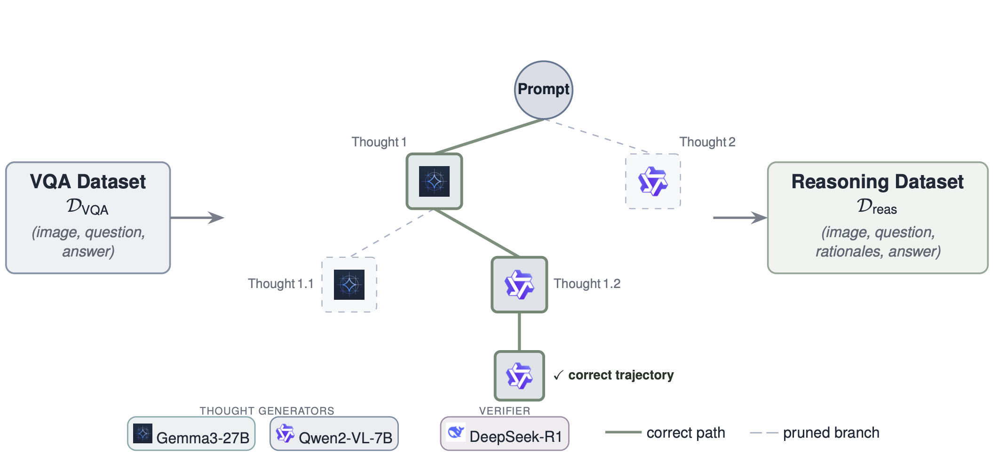
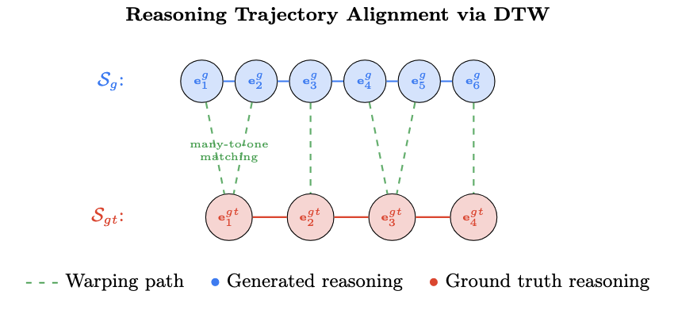
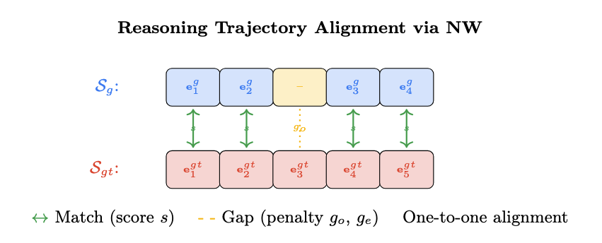

<h1 align="center">Improving Medical VQA through<br>Trajectory-Aware Process Supervision</h1>

<p align="center">
  <b>Halil Ibrahim Gulluk</b><sup>1</sup> &nbsp;·&nbsp; <b>Olivier Gevaert</b><sup>2</sup><br>
  <sup>1</sup>Department of Electrical Engineering, Stanford University &nbsp;&nbsp;
  <sup>2</sup>Department of Computational Medicine, Stanford University
</p>

<p align="center">
  <i>NeurIPS 2026 · The Third Workshop on GenAI for Health: Agentic Systems, Clinical Trust, and Future Potential</i>
</p>

<p align="center">
  <a href="#citation"></a>
  <a href="LICENSE"></a>
  
  <a href="https://github.com/igulluk/trajectory-aware-med-vqa/actions/workflows/tests.yml"></a>
</p>

<p align="center">
  <a href="#overview">Overview</a> •
  <a href="#installation">Installation</a> •
  <a href="#data">Data</a> •
  <a href="#training-and-inference">Training</a> •
  <a href="#results">Results</a> •
  <a href="#citation">Citation</a>
</p>

---

## Overview

Reasoning is crucial for reliable medical visual question answering (VQA), yet existing datasets rarely include
reasoning explanations. This repository contains the code and data for our work, which:

1. **Generates reasoning trajectories** for six medical VQA benchmarks (VQA-RAD, Slake-VQA, Path-VQA, PMC-VQA,
   OmniMed-VQA, VQA-Med) with the COMCTS algorithm, using open-source vision-language models as thought generators
   and an LLM as the verification judge.
2. **Introduces a trajectory-aware process reward** for reinforcement learning: the **Dynamic Time Warping (DTW)**
   distance between the sentence-embedding sequences of the generated and reference reasoning chains.
3. **Improves answer quality** when the DTW reward is combined with an exact-match reward in GRPO. Across six benchmarks
   with Qwen2.5-VL-3B, mean BLEU-1 rises from 0.640 to **0.723**, BERTScore from 0.844 to **0.880**, and ROUGE-L
   from 0.665 to **0.748**. We also study a **Needleman-Wunsch (NW)** alignment reward as a second instance of
   trajectory-similarity process supervision.

<p align="center">
  
  <br><i>Reasoning-dataset generation with COMCTS.</i>
</p>

### Training pipeline

| Stage | Description |
|:-----:|-------------|
| **1** | **Reasoning data generation**: COMCTS with Gemma-3-27B and Qwen2-VL-7B as thought generators and DeepSeek-R1 as the answer verifier. The resulting datasets are released in [`data/`](data). |
| **2** | **Supervised fine-tuning (SFT)**: LoRA fine-tuning on `<think> reasoning </think><answer> answer </answer>` targets. |
| **3** | **GRPO**: Group Relative Policy Optimization from the SFT model with format, exact-match and trajectory-aware rewards. |

### Trajectory-aware rewards

The generated chain and the reference chain are each split into sentences, the final answer is appended as the last
step, and every step is embedded with [`all-mpnet-base-v2`](https://huggingface.co/sentence-transformers/all-mpnet-base-v2).
A completion that does not follow the `<think>/<answer>` format receives 0.

<table>
<tr>
<td width="50%" valign="top">

**DTW reward** (`dtw_embedding`)

$$\mathcal{R}_{\mathrm{DTW}} = \exp\left(-\mathrm{DTW}(\mathcal{S}_g, \mathcal{S}_{gt}) / m\right)$$

DTW allows **many-to-one** matching, so it tolerates differences in verbosity and phrasing while still penalising
hallucinated or out-of-order steps. Here *m* is the number of reference steps.

</td>
<td width="50%" valign="top">

**NW reward** (`nw_alignment`)

A global alignment with **affine gap penalties** and **one-to-one** matching: a missing step opens a gap, and pairs
with low similarity get an extra penalty. The score is min-max normalised to [0, 1]. NW improves over exact-match-only
training but gives no further gain on top of DTW.

</td>
</tr>
<tr>
<td></td>
<td></td>
</tr>
</table>

| Reward name | Symbol | Description |
|:--|:--:|:--|
| `format` | R<sub>form</sub> | 1 if the output is exactly `<think>…</think><answer>…</answer>` |
| `accuracy` | R<sub>exact</sub> | 1 if the predicted answer matches the reference (case-insensitive) |
| `dtw_embedding` | R<sub>DTW</sub> | DTW alignment of sentence-embedding trajectories (**proposed**) |
| `nw_alignment` | R<sub>NW</sub> | Needleman-Wunsch alignment with affine gaps |

The rewards you list are summed. The paper's main configuration is `accuracy format dtw_embedding`.

---

## Installation

The GRPO trainer comes from [R1-V](https://github.com/StarsfieldAI/R1-V), so set up its environment first:

```bash
git clone https://github.com/StarsfieldAI/R1-V.git
cd R1-V
conda create -n r1-v python=3.11 -y
conda activate r1-v
bash setup.sh
cd ..
```

Then install this repository into the same environment:

```bash
git clone https://github.com/igulluk/trajectory-aware-med-vqa.git
cd trajectory-aware-med-vqa
pip install -r requirements.txt
pip install -e .
```

To check the installation, run the reward unit tests. They take a few seconds on CPU:

```bash
pip install pytest && pytest
```

| Dependency | Version |
|:--|:--|
| Python | ≥ 3.10 (3.11 tested) |
| PyTorch | ≥ 2.0 |
| Transformers | ≥ 4.49 for Qwen2.5-VL, ≥ 4.57 for Qwen3-VL |
| GPUs | Experiments were run on 2× NVIDIA H100 |

---

## Data

[`data/`](data) contains the reasoning-augmented datasets: one JSON file per benchmark with train/test splits.

| File | Benchmark | Train | Test |
|:--|:--|--:|--:|
| `vqa-rad_all.json` | VQA-RAD | 1,782 | 170 |
| `slake-vqa_all.json` | Slake-VQA | 2,080 | 255 |
| `path-vqa_all.json` | Path-VQA | 2,228 | 269 |
| `pmc-vqa_all.json` | PMC-VQA | 5,803 | 675 |
| `omnimed-vqa_all.json` | OmniMed-VQA | 1,318 | 152 |
| `vqa-med_all.json` | VQA-Med 2019 | 4,089 | 457 |

Each record looks like this:

```json
{
  "question": "Is there a skull fracture?",
  "gt_answer": "no",
  "reasoning_answer": "The image is a grayscale MRI scan of a human head ...\nThe final answer is: ...",
  "image": "./VQA-RAD/VQA_RAD Image Folder/synpic57237.jpg",
  "split": "train"
}
```

**Images.** We do not redistribute the medical images. Download each benchmark from its original source and arrange
the images as below, either in the directory you launch from or in a directory you pass as `--image_root`:

```
<image_root>/
├── VQA-RAD/VQA_RAD Image Folder/
├── Slake-VQA/imgs/
├── Path-VQA/pvqa/images/
├── PMC-VQA/images_1/  and  PMC-VQA/images_2/
├── OmniMedVQA/Images/
└── VQA-MED-2019/ImageClef-2019-VQA-Med-Training/Train_images/
```

---

## Training and inference

Each stage has a launch script with the paper's hyperparameters. Every script takes the dataset name as its first
argument (`vqa-rad`, `slake-vqa`, `path-vqa`, `pmc-vqa`, `omnimed-vqa`, `vqa-med`), and any further flags are passed
through to the Python entry point.

```bash
# 1. SFT (LoRA), 1 GPU by default
bash scripts/train_sft.sh slake-vqa

# 2. GRPO with R_form + R_exact + R_DTW, 2 GPUs by default
bash scripts/train_grpo.sh slake-vqa "accuracy format dtw_embedding"

#    ... or with the NW reward
bash scripts/train_grpo.sh slake-vqa "accuracy format nw_alignment"

# 3. Generate test-set predictions -> results/slake-vqa/accuracy_format_dtw_embedding.json
bash scripts/run_inference.sh slake-vqa "accuracy format dtw_embedding"
```

The scripts read these environment variables: `NUM_GPUS`, `OUTPUT_DIR`, `SFT_CHECKPOINT` and `GRPO_CHECKPOINT`.
To train Qwen3-VL-4B, pass the model id as the last positional argument, e.g.
`bash scripts/train_sft.sh slake-vqa Qwen/Qwen3-VL-4B-Instruct`.

<details>
<summary><b>Full commands</b></summary>

```bash
torchrun --nproc_per_node=2 scripts/grpo.py \
    --model_name_or_path Qwen/Qwen2.5-VL-3B-Instruct \
    --sft_checkpoint_path checkpoints/sft/slake-vqa/checkpoint-best \
    --data_json_path data/slake-vqa_all.json \
    --dataset_name MedVQA \
    --reward_funcs accuracy format dtw_embedding \
    --output_dir checkpoints/grpo/slake-vqa/accuracy_format_dtw_embedding \
    --deepspeed configs/zero2.json \
    --max_prompt_length 512 --max_completion_length 512 --num_generations 8 \
    --per_device_train_batch_size 1 --gradient_accumulation_steps 64 \
    --learning_rate 2e-5 --lr_scheduler_type constant --num_train_epochs 10 \
    --bf16 --attn_implementation sdpa \
    --eval_strategy steps --eval_steps 10 --save_steps 10 --save_total_limit 10 \
    --load_best_model_at_end true --metric_for_best_model eval_reward --greater_is_better true \
    --early_stopping_patience 25 --report_to wandb --seed 42
```

Further GRPO options: `--sentence_transformer_model`, `--nw_gap_open` (default −0.5), `--nw_gap_extend` (−0.1),
`--nw_mismatch_penalty` (−0.3), `--nw_similarity_threshold` (0.3) and `--image_root`.
Run `python scripts/<script>.py --help` to see all arguments.

</details>

**Debugging rewards.** Run with `DEBUG_MODE=true LOG_PATH=rewards.log` to log every completion and its reward.

---

## Results

Results with Qwen2.5-VL-3B on six medical VQA benchmarks under four training configurations. The full combination
**R<sub>form</sub> + R<sub>exact</sub> + R<sub>DTW</sub>** has the highest mean on every metric.

<details open>
<summary><b>BLEU-1</b></summary>

| Dataset | SFT | R<sub>form</sub> | R<sub>form</sub> + R<sub>exact</sub> | R<sub>form</sub> + R<sub>exact</sub> + R<sub>DTW</sub> |
|---|:-:|:-:|:-:|:-:|
| Path-VQA | 0.515 | 0.644 | 0.665 | **0.713** |
| PMC-VQA | 0.666 | 0.669 | 0.715 | **0.739** |
| VQA-RAD | 0.597 | 0.572 | 0.681 | **0.695** |
| Slake-VQA | 0.786 | 0.745 | 0.791 | **0.841** |
| VQA-Med | 0.705 | 0.713 | 0.740 | **0.758** |
| OmniMed-VQA | 0.569 | 0.478 | 0.574 | **0.592** |
| **Mean** | 0.640 | 0.637 | 0.694 | **0.723** |

</details>

<details>
<summary><b>METEOR</b></summary>

| Dataset | SFT | R<sub>form</sub> | R<sub>form</sub> + R<sub>exact</sub> | R<sub>form</sub> + R<sub>exact</sub> + R<sub>DTW</sub> |
|---|:-:|:-:|:-:|:-:|
| Path-VQA | 0.261 | 0.325 | 0.335 | **0.359** |
| PMC-VQA | 0.571 | 0.572 | 0.612 | **0.633** |
| VQA-RAD | 0.316 | 0.304 | 0.360 | **0.367** |
| Slake-VQA | 0.428 | 0.408 | 0.435 | **0.464** |
| VQA-Med | 0.466 | 0.466 | 0.483 | **0.493** |
| OmniMed-VQA | 0.424 | 0.345 | 0.416 | **0.440** |
| **Mean** | 0.411 | 0.403 | 0.440 | **0.459** |

</details>

<details>
<summary><b>COMET</b></summary>

| Dataset | SFT | R<sub>form</sub> | R<sub>form</sub> + R<sub>exact</sub> | R<sub>form</sub> + R<sub>exact</sub> + R<sub>DTW</sub> |
|---|:-:|:-:|:-:|:-:|
| Path-VQA | 0.810 | 0.847 | 0.852 | **0.864** |
| PMC-VQA | 0.813 | 0.811 | 0.835 | **0.847** |
| VQA-RAD | 0.826 | 0.824 | 0.861 | **0.864** |
| Slake-VQA | 0.909 | 0.900 | 0.915 | **0.929** |
| VQA-Med | 0.852 | 0.852 | 0.864 | **0.874** |
| OmniMed-VQA | 0.801 | 0.757 | 0.797 | **0.804** |
| **Mean** | 0.835 | 0.832 | 0.854 | **0.864** |

</details>

<details>
<summary><b>BERTScore</b></summary>

| Dataset | SFT | R<sub>form</sub> | R<sub>form</sub> + R<sub>exact</sub> | R<sub>form</sub> + R<sub>exact</sub> + R<sub>DTW</sub> |
|---|:-:|:-:|:-:|:-:|
| Path-VQA | 0.776 | 0.833 | 0.847 | **0.861** |
| PMC-VQA | 0.867 | 0.866 | 0.888 | **0.898** |
| VQA-RAD | 0.813 | 0.800 | 0.858 | **0.863** |
| Slake-VQA | 0.913 | 0.895 | 0.915 | **0.935** |
| VQA-Med | 0.867 | 0.871 | 0.885 | **0.891** |
| OmniMed-VQA | 0.830 | 0.777 | 0.822 | **0.832** |
| **Mean** | 0.844 | 0.840 | 0.869 | **0.880** |

</details>

<details>
<summary><b>ROUGE-L F1</b></summary>

| Dataset | SFT | R<sub>form</sub> | R<sub>form</sub> + R<sub>exact</sub> | R<sub>form</sub> + R<sub>exact</sub> + R<sub>DTW</sub> |
|---|:-:|:-:|:-:|:-:|
| Path-VQA | 0.521 | 0.647 | 0.669 | **0.716** |
| PMC-VQA | 0.682 | 0.684 | 0.729 | **0.752** |
| VQA-RAD | 0.629 | 0.611 | 0.722 | **0.734** |
| Slake-VQA | 0.805 | 0.761 | 0.806 | **0.851** |
| VQA-Med | 0.705 | 0.716 | 0.744 | **0.760** |
| OmniMed-VQA | 0.648 | 0.568 | 0.649 | **0.676** |
| **Mean** | 0.665 | 0.664 | 0.720 | **0.748** |

</details>

<details>
<summary><b>Accuracy (supplementary)</b></summary>

| Dataset | SFT | R<sub>form</sub> | R<sub>form</sub> + R<sub>exact</sub> | R<sub>form</sub> + R<sub>exact</sub> + R<sub>DTW</sub> |
|---|:-:|:-:|:-:|:-:|
| Path-VQA | 0.514 | 0.643 | 0.664 | **0.710** |
| PMC-VQA | 0.546 | 0.558 | 0.613 | **0.641** |
| VQA-RAD | 0.578 | 0.547 | 0.665 | **0.676** |
| Slake-VQA | 0.768 | 0.723 | 0.773 | **0.822** |
| VQA-Med | 0.681 | 0.688 | 0.717 | **0.733** |
| OmniMed-VQA | 0.520 | 0.427 | 0.537 | **0.572** |
| **Mean** | 0.601 | 0.598 | 0.661 | **0.692** |

</details>

---

## Repository structure

```
trajectory-aware-med-vqa/
├── medvqa/                     # installable package
│   ├── prompts.py              # system prompts and chat-message construction
│   ├── data.py                 # dataset loading and train/test split
│   ├── modeling.py             # Qwen2-VL / Qwen2.5-VL / Qwen3-VL selection, LoRA merging
│   ├── checkpointing.py        # resumption, including across different GPU counts
│   └── rewards/
│       ├── outcome.py          # R_form, R_exact
│       ├── alignment.py        # DTW and Needleman-Wunsch primitives
│       ├── trajectory.py       # R_DTW, R_NW reward functions
│       └── parsing.py          # <think>/<answer> parsing, sentence splitting
├── scripts/
│   ├── sft.py · grpo.py · inference.py      # entry points
│   └── train_sft.sh · train_grpo.sh · run_inference.sh
├── configs/                    # DeepSpeed ZeRO-2 / ZeRO-3
├── data/                       # reasoning-augmented datasets
├── tests/                      # CPU unit tests for the rewards
└── assets/
```

---

## Citation

If you find this work useful, please cite:

```bibtex
@inproceedings{gulluk2026trajectory,
  title     = {Improving Medical {VQA} through Trajectory-Aware Process Supervision},
  author    = {Gulluk, Halil Ibrahim and Gevaert, Olivier},
  booktitle = {The Third Workshop on GenAI for Health: Agentic Systems, Clinical Trust, and Future Potential, NeurIPS 2026},
  year      = {2026}
}
```

## Acknowledgements

This codebase builds on [R1-V](https://github.com/StarsfieldAI/R1-V) and [open-r1](https://github.com/huggingface/open-r1),
and uses the [Qwen-VL](https://github.com/QwenLM/Qwen2.5-VL) models and
[Sentence-Transformers](https://www.sbert.net/). We thank the authors of VQA-RAD, SLAKE, PathVQA, PMC-VQA,
OmniMedVQA and VQA-Med for releasing their benchmarks.

## License

The code is released under the [Apache License 2.0](LICENSE). The images and original question–answer pairs remain
under the licenses of their respective benchmarks.
